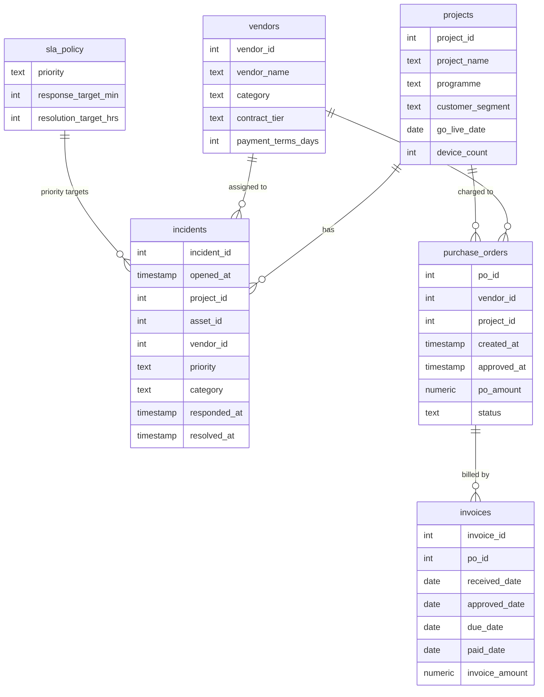
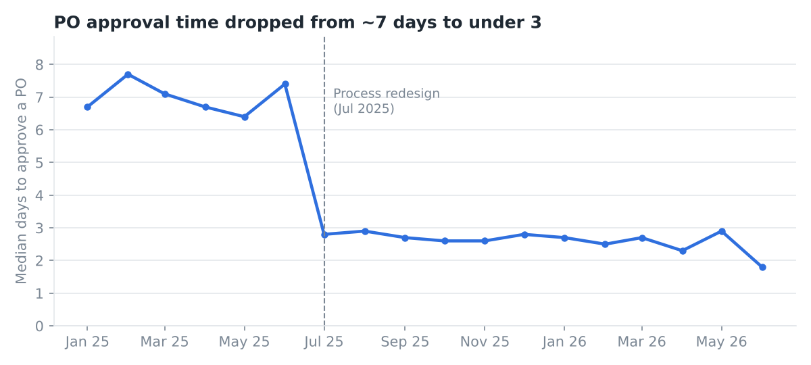
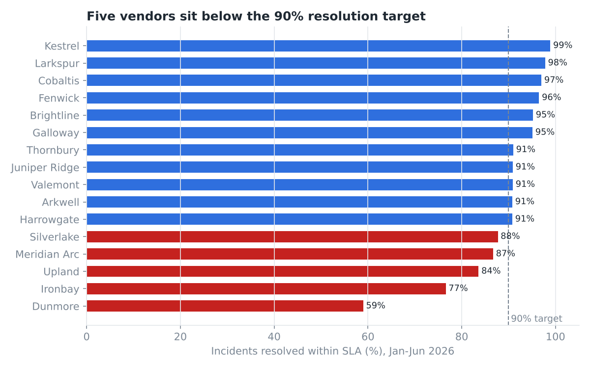

# Vendor SLA & Procure-to-Pay Analytics in SQL

PostgreSQL project that answers the questions an operations team asks every month about its vendors:
*Are they meeting SLA? Who is getting better or worse? Are the same faults coming back? How long does it take to get a purchase order approved and an invoice paid?*

Everything is written in plain SQL with **CTEs** and **window functions** (`LAG`, `RANK`, `DENSE_RANK`, `NTILE`, `ROW_NUMBER`, `PERCENT_RANK`, running and rolling `SUM`/`AVG`/`MAX`), plus `PERCENTILE_CONT` and `FILTER`.

> **Data note:** all data is synthetic, generated by `scripts/generate_data.py`. *Halden Networks*, its projects and its 25 vendors are invented. The scenario is modelled on the kind of work I do in IoT and telecom operations (vendor SLAs, ITIL incident management, procure-to-pay), but no real company, customer or vendor data is used.

## The scenario

Halden Networks runs 20 IoT projects (smart metering, public safety, smart buildings, fleet telematics) with field, network and software work outsourced to 25 vendors. Between January 2025 and June 2026 it logged **12,521 incidents**, **1,376 purchase orders** and **1,468 invoices**.

Two improvement initiatives happened during that time, and the analysis checks whether they worked:
- **July 2025:** the PO approval process was redesigned to remove manual steps.
- **October 2025:** a root-cause programme started, targeting assets with recurring faults.

## Data model



## Questions and the SQL behind them

| # | Business question | Main techniques | Query | Result |
|---|---|---|---|---|
| 1 | How is each vendor's SLA compliance trending month to month? | CTEs, `AVG() OVER` rolling 3-month frame, `LAG()` | [sql](sql/01_sla_monthly_trend.sql) | [csv](results/01_sla_monthly_trend.csv) |
| 2 | Who are the best and worst vendors each quarter, and who is moving? | `RANK()`, `NTILE(4)`, `LAG()` on rank | [sql](sql/02_vendor_quarterly_ranking.sql) | [csv](results/02_vendor_quarterly_ranking.csv) |
| 3 | How many incidents are repeats, and did the root-cause programme help? | `LAG()` per asset and category, `FILTER`, `ROW_NUMBER()` | [sql](sql/03_repeat_incidents.sql) | [csv](results/03_repeat_incidents.csv) |
| 4 | How big was the open backlog each day, and when did it peak? | Running `SUM() OVER`, rolling `MAX()`/`AVG()` | [sql](sql/04_open_backlog_running_total.sql) | [csv](results/04_open_backlog_running_total.csv) |
| 5 | What is normal resolution time per priority, and who causes the outliers? | `PERCENTILE_CONT`, `PERCENT_RANK()`, `SUM() OVER ()` | [sql](sql/05_resolution_outliers.sql) | [csv](results/05_resolution_outliers.csv) |
| 6 | How long does procure-to-pay take, and did the redesign help? | Medians per month, rolling `AVG() OVER`, conditional counts | [sql](sql/06_p2p_cycle_time.sql) | [csv](results/06_p2p_cycle_time.csv) |
| 7 | Which vendors make up most of our spend? (Pareto / ABC) | Cumulative `SUM() OVER (ORDER BY ...)`, share of total | [sql](sql/07_vendor_spend_pareto.sql) | [csv](results/07_vendor_spend_pareto.csv) |
| 8 | Which vendors have the longest run of months above a 95% SLA? | Gaps and islands with `ROW_NUMBER()` | [sql](sql/08_sla_streaks.sql) | [csv](results/08_sla_streaks.csv) |
| 9 | One scorecard that ranks vendors on SLA and repeat faults | Multi-CTE join, `PERCENT_RANK()` scoring, `DENSE_RANK()` | [sql](sql/09_vendor_scorecard.sql) | [csv](results/09_vendor_scorecard.csv) |

## What the data says

**1. The PO redesign worked, but late payments didn't improve much.**
The median time to approve a PO fell from about **7.0 days to 2.6 days** after July 2025, and invoice approval fell from **6.5 to 4.0 days**. Yet the share of invoices paid on time only moved from **63% to 66%**. Approval is no longer the bottleneck; the next place to look is the payment run itself.



**2. The root-cause programme almost halved repeat faults.**
Before October 2025, **11.5%** of incidents were repeats (same asset, same fault, within 7 days of the last one). After the programme started, that fell to **6.2%**.

**3. Five vendors are below target, including a strategic one.**
In January to June 2026, five of the 16 vendors with enough volume to rank resolved fewer than 90% of incidents within SLA. Dunmore Services was lowest at **59%**. Ironbay Services, a *Strategic* tier vendor, came second-to-last at **77%**. Across the full 18 months, Ironbay alone produced **18%** of the slowest 5% of incidents.



**4. The biggest vendor by spend is also below SLA.**
13 of 25 vendors account for 80% of invoiced spend. The largest, Silverlake Services (**16%** of all spend), resolved only **88%** of incidents within SLA. That combination makes it the first candidate for a contract and performance review.

**5. Backlog peaks in summer.** The open-incident backlog peaked at **40** open incidents in early June 2025, when summer incident volume rises.

## Two techniques worth a closer look

**Running backlog from open/close events** (query 4). Each incident becomes a +1 when it opens and a -1 when it closes. A running sum over the days then gives the open backlog at any point:

```sql
WITH events AS (
    SELECT opened_at::date AS day, 1 AS delta FROM incidents
    UNION ALL
    SELECT resolved_at::date, -1 FROM incidents WHERE resolved_at IS NOT NULL
), daily AS (
    SELECT day, SUM(delta) AS net_change FROM events GROUP BY day
)
SELECT day,
       SUM(net_change) OVER (ORDER BY day ROWS UNBOUNDED PRECEDING) AS open_backlog
FROM daily;
```

**Gaps and islands for SLA streaks** (query 8). For months where a vendor met the target, `month number - ROW_NUMBER()` stays the same within an unbroken run, so grouping by that value finds each streak:

```sql
SELECT vendor_id, month,
       month_idx - ROW_NUMBER() OVER (PARTITION BY vendor_id ORDER BY month) AS island_key
FROM hits;   -- then GROUP BY vendor_id, island_key and COUNT(*) the months
```

## How to run it

Requires PostgreSQL 14 or later and Python 3 (only to regenerate the data or the charts).

```bash
git clone https://github.com/Abdullah2796/vendor-sla-p2p-sql.git
cd vendor-sla-p2p-sql
./scripts/run_all.sh            # creates database "vendor_ops", loads data/, runs every query into results/
python3 scripts/make_charts.py  # optional: rebuilds the two charts (needs matplotlib)
```

To regenerate the synthetic data with a different seed, edit `random.seed(42)` in `scripts/generate_data.py` and run it before `run_all.sh`.

## Repository layout

```
data/       synthetic CSVs (6 tables)
sql/        00_schema.sql + 9 analysis queries, each commented with the business question
results/    output of every query as CSV
scripts/    data generator, run_all.sh, chart script
images/     charts used in this README
```

---
Built by [Abdullah Mohamad Alsayed](https://www.linkedin.com/in/abdullah-alsayed-2a7b29163/). Tested on PostgreSQL 16.
